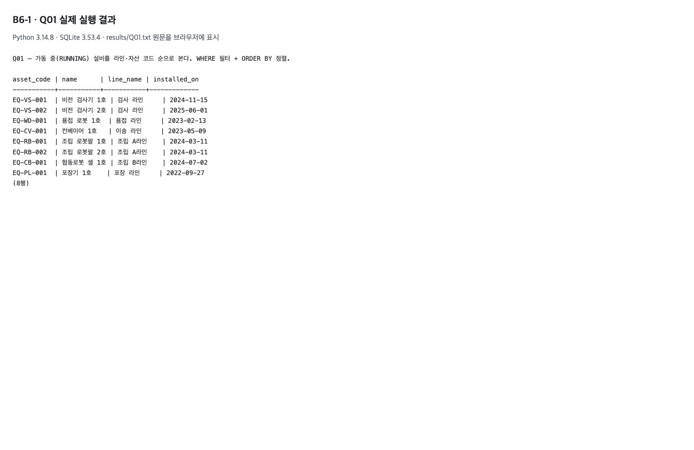
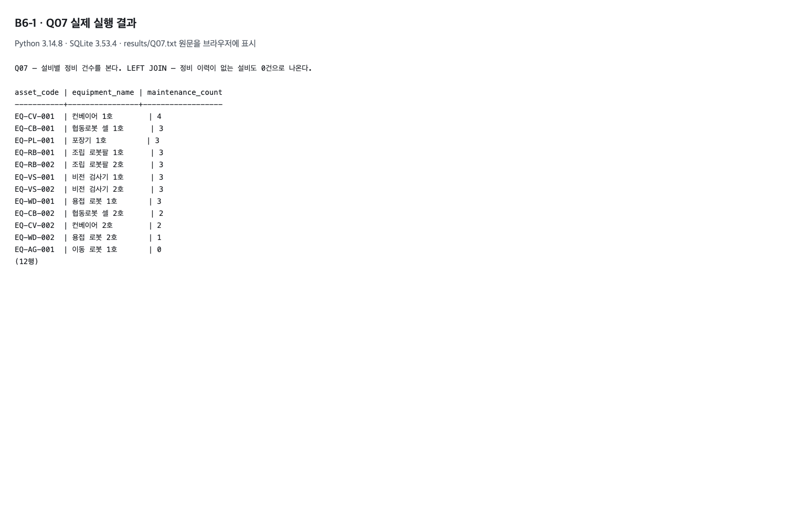
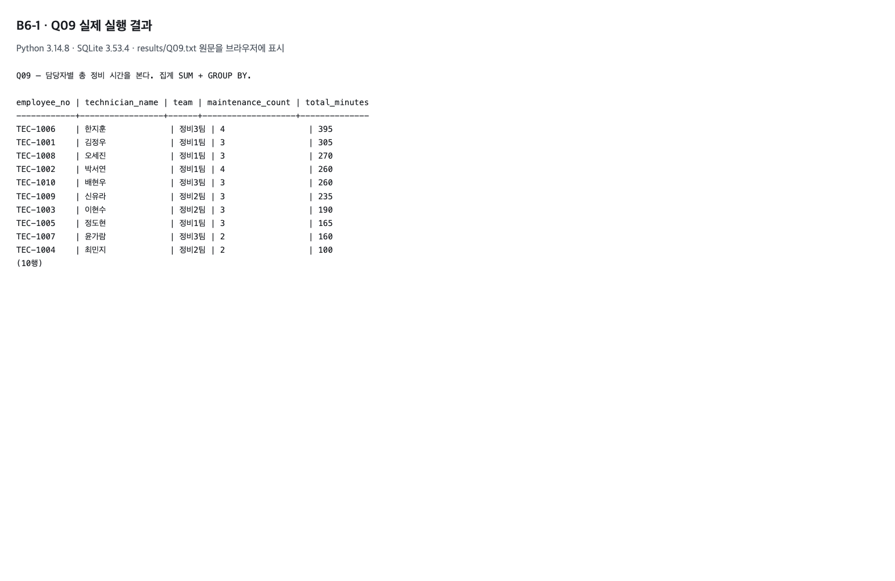
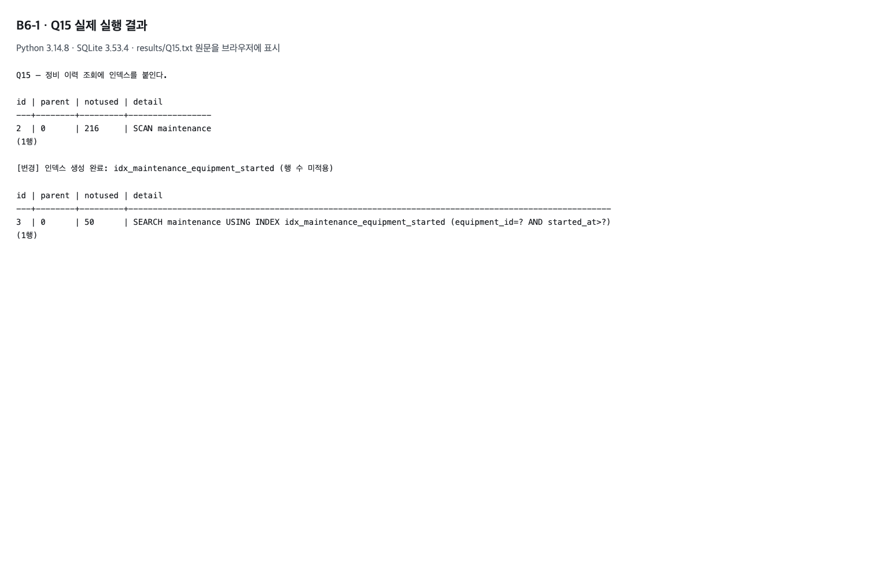
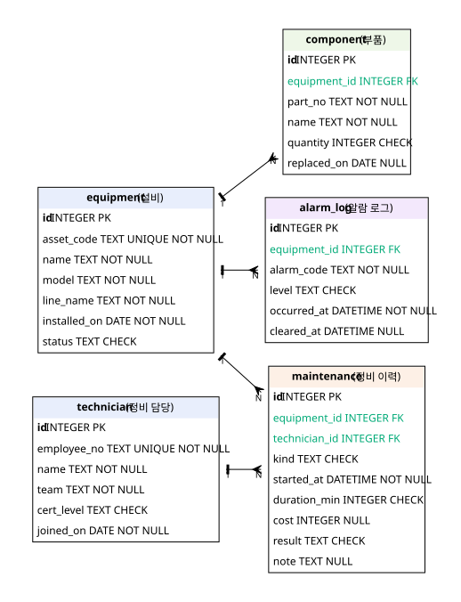
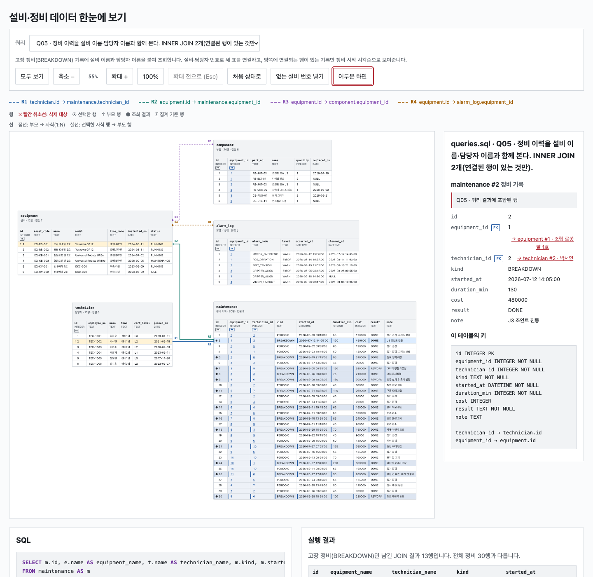

# B6-1 정보를 깔끔하게 정리하는 디지털 서랍장 만들기

코딧세이 AI 올인원 본과정 B6-1 미션 저장소입니다.

## 소재
스마트팩토리의 설비·부품·정비 이력·담당자·알람을 SQLite로 관리한다. 설비 한 대에 여러 부품과 정비 이력, 알람이 연결되도록 테이블을 나눴다.

## 구현 내용
테이블 5개, 1:N 관계 4개, 테이블당 샘플 데이터 10행 이상, 쿼리 15개와 복합 인덱스 1개를 작성했다.

## 개발 환경
SQLite와 `sqlite3` CLI를 사용한다. 결과를 일괄 생성할 때는 Python 3를 사용한다.

## 파일 구성

| 파일 | 내용 |
| --- | --- |
| [`schema.sql`](schema.sql) | 테이블 5개 생성(`CREATE TABLE`) — PK·FK·제약조건·타입 주석 |
| [`seed.sql`](seed.sql) | 샘플 데이터 입력(`INSERT`) — 테이블당 10행 이상 |
| [`queries.sql`](queries.sql) | 핵심 쿼리 15개 + 각 쿼리 한 줄 설명 + 인덱스 |
| [`QUERIES.md`](QUERIES.md) | 쿼리 15개를 한 쿼리마다 설명·SQL 전문·실행 결과 전체로 정리한 문서 |
| [`results/`](results) | 쿼리별 실행 결과 텍스트(`Q01`~`Q15`)·요약·보너스 3건 |
| [`erd.svg`](erd.svg) · [`erd.dot`](erd.dot) | 테이블 관계도(ERD) 이미지와 생성 원본 |
| [`scripts/capture_results.py`](scripts/capture_results.py) | 스키마·샘플 데이터를 새로 채우고 결과를 다시 만드는 스크립트 |
| [`showcase/drawer-light.html`](showcase/drawer-light.html) · [`drawer.html`](showcase/drawer.html) | 설비·정비 데이터 한눈에 보기 — 쿼리·행 선택을 지원하는 오프라인 시연판 |

## 실행 방법

저장소 루트에서 스키마, 샘플 데이터, 쿼리 순서로 실행한다. 기존 `b6-1.sqlite3`가 있다면 먼저 복사해 보관한다. 아래 명령은 기존 DB를 지우고 다시 만든다.

```bash
rm -f b6-1.sqlite3
sqlite3 -cmd 'PRAGMA foreign_keys = ON' b6-1.sqlite3 < schema.sql
sqlite3 -cmd 'PRAGMA foreign_keys = ON' b6-1.sqlite3 < seed.sql
sqlite3 -cmd 'PRAGMA foreign_keys = ON' b6-1.sqlite3 < queries.sql
```

외래 키 검사는 연결마다 켜야 하므로 각 명령에 `-cmd 'PRAGMA foreign_keys = ON'`을 붙였다. `UPDATE`·`DELETE` 실행 후에는 데이터가 바뀌므로, 결과를 다시 비교하려면 샘플 데이터부터 새로 적용한다.

쿼리별 결과를 `results/`에 일괄 저장하려면 다음 명령을 실행한다. 이 명령도 기존 DB를 다시 만든다.

```bash
python3 scripts/capture_results.py
```

`queries.sql`은 표준 SQL 범위로 썼습니다. SQLite 고유 문법을 쓴 곳은 두 군데뿐이고, 해당 위치에 주석으로 표시했습니다.

- `schema.sql`의 `AUTOINCREMENT`(자동 증가 키), `PRAGMA foreign_keys = ON`(외래 키 검사 켜기)
- `queries.sql` Q15의 `EXPLAIN QUERY PLAN`(실행 계획 출력)

## 데이터 설계

- 테이블 5개: `equipment`(설비), `technician`(정비 담당), `component`(부품), `maintenance`(정비 이력), `alarm_log`(알람 로그).
- 1:N 관계 4개: 설비→부품, 설비→정비 이력, 담당자→정비 이력, 설비→알람 로그.
- 제약조건: `asset_code`·`employee_no`에 `UNIQUE`, 주요 컬럼에 `NOT NULL`, `status`·`cert_level`·`kind`·`result`에 `CHECK`(정해진 값만 저장), 부품 수량 `CHECK (quantity > 0)`.
- 타입: 날짜만 필요하면 `DATE`, 시각까지 필요하면 `DATETIME`, 값·식별자는 `TEXT`, 개수·시간은 `INTEGER`로 의도를 나타냈다. SQLite의 `DATE`·`DATETIME`은 전용 날짜 저장 타입이나 형식 검증이 아니라 NUMERIC 타입 친화도 선언이다. 현재 시드의 날짜 값은 `YYYY-MM-DD`와 `YYYY-MM-DD HH:MM:SS` 형식의 TEXT로 저장되어, 같은 형식끼리의 문자열 비교가 날짜 순서와 일치한다. 날짜가 아닌 문자열도 저장될 수 있으므로 날짜 유효성 검증을 보장하지 않는다. 일반 `INTEGER` 컬럼 역시 타입 친화도이며, 정수만 저장하도록 강제하는 선언과는 다르다.
- 외래 키: `schema.sql` 첫 줄의 `PRAGMA foreign_keys = ON`이 있어야 실제로 막힌다(SQLite 기본값은 꺼짐). 이 검사는 연결마다 켜야 하므로 CLI에서는 `-cmd 'PRAGMA foreign_keys = ON'`을 함께 준다. 검사가 켜진 상태에서 없는 부모를 거부한 1건은 `results/bonus2-fk-violation.txt`에 있다.
- 인덱스 1개: `idx_maintenance_equipment_started` — `maintenance (equipment_id, started_at)`. 설비 하나의 기간별 정비 이력 조회가 가장 잦아, 설비로 먼저 좁히고 그 안에서 기간을 자르게 했다. 이유와 전후 실행 계획은 `queries.sql`의 Q15에 있다.

## 엑셀·파일 대신 데이터베이스를 쓴 이유

같은 표를 엑셀 파일로도 만들 수 있다. 그래도 여기서는 테이블로 나눠 저장했고, 그 차이는 아래 지점에서 드러난다.

- **관계를 값으로 잇는다**: 엑셀도 참조 함수와 분리된 시트로 중복을 줄일 수 있다. 이 구현에서는 설비 이름을 `equipment` 한 행에만 두고 `maintenance.equipment_id`가 그 행의 번호를 참조한다. 이름을 한 번 고치면 조인 결과에도 새 이름이 나온다.
- **참조 무결성을 스키마로 검사한다**: 엑셀도 유효성 검사로 입력을 제한할 수 있지만, 이는 DB의 테이블 간 FK 제약과 같은 기능은 아니다. 이 구현은 연결별로 FK 검사를 켠 상태에서 없는 설비 번호를 참조하는 입력을 거부한다(`results/bonus2-fk-violation.txt`).
- **누락·중복·범위를 제약조건으로 검사한다**: `NOT NULL`·`UNIQUE`·`CHECK`가 값의 누락·중복·허용 범위를 저장 단계에서 검사한다. 엑셀 유효성 검사는 복사·붙여넣기 등 입력 경로에 따른 제한이 있어 DB 제약조건과 보장 범위를 구분해야 한다.
- **동시 접근 방식이 다르다**: 파일 사본을 각자 수정한 뒤 같은 경로에 덮어쓰는 방식과 OneDrive·SharePoint의 Excel 공동 편집은 다르다. 공동 편집은 여러 사람의 변경을 반영하므로 단순한 파일 덮어쓰기로 일반화할 수 없다. SQLite는 여러 연결이 읽을 수 있지만 쓰기는 한 번에 하나로 직렬화한다. 트랜잭션은 묶인 변경을 함께 확정하거나 취소하는 데 쓴다.
- **관계와 규칙을 쿼리에서 재사용한다**: 엑셀도 참조 함수·피벗으로 비슷한 조회·집계를 할 수 있다. 이 미션의 초점은 엑셀에 같은 결과를 만들 기능이 없다는 것이 아니라, 관계와 무결성 규칙을 스키마로 관리하고 SQL로 조회·집계한다는 점이다.

공식 근거: SQLite의 [데이터 타입](https://www.sqlite.org/datatype3.html)·[외래 키](https://www.sqlite.org/foreignkeys.html)·[트랜잭션 격리](https://www.sqlite.org/isolation.html), Microsoft의 [Excel 공동 편집](https://support.microsoft.com/en-us/excel/get-started/collaborate-on-excel-workbooks-at-the-same-time-with-co-authoring).

## 핵심 개념 정리

- **PK vs FK**: PK(Primary Key)는 그 행 하나를 가리키는 고유 이름표다. `equipment.id`처럼 행마다 다르고 비어 있을 수 없다. FK(Foreign Key)는 다른 표의 PK를 가리키는 연결 고리다. `maintenance.equipment_id`가 `equipment.id`를 가리키는 식이다. PK는 "이 행은 누구인가", FK는 "이 행은 누구와 이어져 있나"를 담당한다.
- **1:N 관계**: 한 부모 행에 여러 자식 행이 붙는 관계다. 설비 한 대에 정비 이력이 여러 건 붙는 것이 그 예다. 자식 쪽(`maintenance`)이 부모의 id(`equipment_id`)를 값으로 들고 있어, 이 값으로 둘을 이어 붙인다.
- **INNER JOIN vs LEFT JOIN**: `INNER JOIN`은 양쪽에 짝이 있는 행만 남긴다. `LEFT JOIN`은 왼쪽 표의 행을 모두 남기고, 오른쪽에 짝이 없으면 그 자리를 `NULL`로 채운다. Q07에서 정비 이력이 없는 설비(`EQ-AG-001`)를 0건으로 남기는 데 `LEFT JOIN`을 썼다.
- **GROUP BY와 집계 함수**: `GROUP BY`로 행을 기준별로 묶고, 묶음마다 `COUNT`(건수)·`SUM`(합계)·`AVG`(평균)를 계산한다. Q09는 담당자별로 묶어 총 정비 시간을, Q10은 설비별로 묶어 평균·최대 시간을 구한다. 묶은 뒤의 조건은 `WHERE`가 아니라 `HAVING`으로 건다(Q10의 `HAVING COUNT(m.id) >= 2`).
- **SELECT / INSERT / UPDATE / DELETE**: `SELECT`는 조회, `INSERT`는 새 행 입력, `UPDATE`는 기존 값 변경, `DELETE`는 행 삭제다. 데이터를 바꾸는 쿼리(Q13·Q14)는 조회(Q01~Q12) 뒤에 둔다.
- **인덱스**: 특정 컬럼 기준으로 찾을 때 표 전체를 훑지 않도록 미리 정렬해 둔 색인이다. 자주 조건으로 쓰는 컬럼에 붙인다. Q15는 `maintenance (equipment_id, started_at)`에 붙여, 실행 계획이 전체 훑기(`SCAN`)에서 인덱스 탐색(`SEARCH ... USING INDEX`)으로 바뀌는 것을 보여준다.

## 쿼리 15개

> [!TIP]
> 쿼리별 한 줄 설명·SQL 전문·실행 결과 전체는 **[`QUERIES.md`](QUERIES.md)** 에 모아 두었다.

쿼리 본문은 [`queries.sql`](queries.sql)에, 각 쿼리의 실행 결과는 `results/`의 `Q01.txt`~`Q15.txt`에 있다.

- 기본 조회: [Q01](results/Q01.txt) · [Q02](results/Q02.txt) · [Q03](results/Q03.txt) · [Q04](results/Q04.txt)
- 조인: [Q05](results/Q05.txt) · [Q06](results/Q06.txt) · [Q07](results/Q07.txt) · [Q08](results/Q08.txt)
- 집계: [Q09](results/Q09.txt) · [Q10](results/Q10.txt) · [Q11](results/Q11.txt)
- 서브쿼리: [Q12](results/Q12.txt)
- 수정·삭제: [Q13](results/Q13.txt) · [Q14](results/Q14.txt)
- 인덱스: [Q15](results/Q15.txt)

범주 분포는 기본 조회 4, 조인 4(`INNER` 2·`LEFT` 2), 집계 3(`COUNT`·`SUM`·`AVG`), 서브쿼리 1, 수정·삭제 2, 인덱스 1이다.

## 실행 화면

주요 쿼리 5개를 실제로 실행해 생성한 `results/`의 텍스트 원문을 브라우저에 표시한 이미지다. 터미널 자체를 촬영한 이미지는 아니며, Q15도 `queries.sql`의 설비 5번·2026-07-01 이후 조건을 실행한 결과다.







## 보너스

세 과제를 모두 [`scripts/capture_results.py`](scripts/capture_results.py)에서 재현하고 결과를 남겼다.

- [보너스 1 — 같은 요구를 `JOIN`과 서브쿼리 두 방식으로](results/bonus1-join-vs-subquery.txt): "정비 이력이 있는 설비"를 `INNER JOIN`과 `EXISTS`로 각각 뽑아 결과가 같음을 확인하고, 언제 어느 쪽을 쓰는지 비교했다.
- [보너스 2 — 데이터 정합성 깨뜨려 보기](results/bonus2-fk-violation.txt): 검사가 켜진 상태에서 없는 부모 값(`equipment_id = 999`)을 넣어 `FOREIGN KEY constraint failed`로 막히는 것과 고치는 방법을 기록했다. 꺼진 상태와의 비교 실행은 이 파일에 담지 않았다.
- [보너스 3 — 핵심 지표 미니 리포트](results/bonus3-mini-report.txt): 이 DB로 뽑는 핵심 지표 3개(설비별 총 정비 시간 상위, 라인별 고장 정비 건수, 정비 담당자별 평균 처리 시간)와 각 지표 SQL을 정리했다.

## 테이블 관계 (ERD)



- `equipment`(설비) 1 : N `component`(부품)
- `equipment`(설비) 1 : N `maintenance`(정비 이력)
- `technician`(정비 담당) 1 : N `maintenance`(정비 이력)
- `equipment`(설비) 1 : N `alarm_log`(알람 로그)

## 작업 중 겪은 문제와 해결

- **수정·삭제 후 재실행**: `UPDATE`·`DELETE`를 실행하면 데이터가 바뀌어 같은 조회의 결과도 달라진다. 결과를 비교할 때는 스키마와 샘플 데이터를 다시 적용해 같은 초기 상태에서 실행했다.
- **외래 키 검사**: SQLite는 연결마다 `PRAGMA foreign_keys = ON`을 켜야 외래 키를 검사한다. 검사를 켠 뒤 없는 설비 번호를 참조하는 정비 기록을 넣어 `FOREIGN KEY constraint failed`로 거부되는 것을 확인했다.
- **인덱스 적용**: 설비 번호와 시작 시각으로 정비 기록을 조회할 때 실행 계획이 전체 훑기(`SCAN`)로 나왔다. `(equipment_id, started_at)` 복합 인덱스를 추가하고 Q15에서 인덱스 탐색(`SEARCH ... USING INDEX`)으로 바뀌는 것을 확인했다.

## 대화형 시연판

저장소를 내려받은 뒤 [`showcase/drawer-light.html`](showcase/drawer-light.html)을 Chrome에서 연다. 어두운 화면은 [`showcase/drawer.html`](showcase/drawer.html)이다.

- 쿼리 선택: 해당 쿼리의 설명·SQL·실행 결과와 관련 행을 확인한다.
- 자식 표의 id 선택: 그 행이 참조하는 부모 행을 확인한다.
- 표 머리글 선택: 표를 확대한다. **확대 전으로 (Esc)** 버튼이나 **Esc**로 이전 화면으로 돌아간다.

시연판은 저장된 SQL 실행 결과를 보여주며, 실제 DB의 데이터를 바꾸지 않는다.


